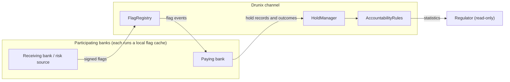
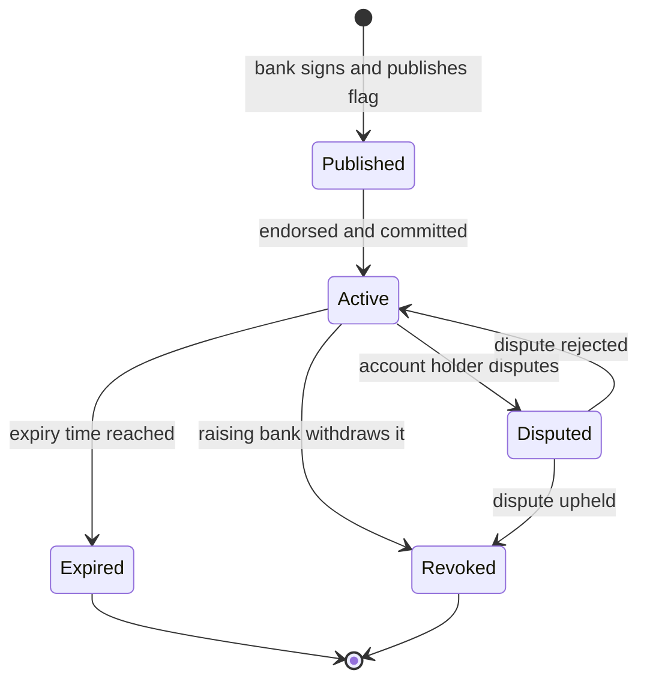
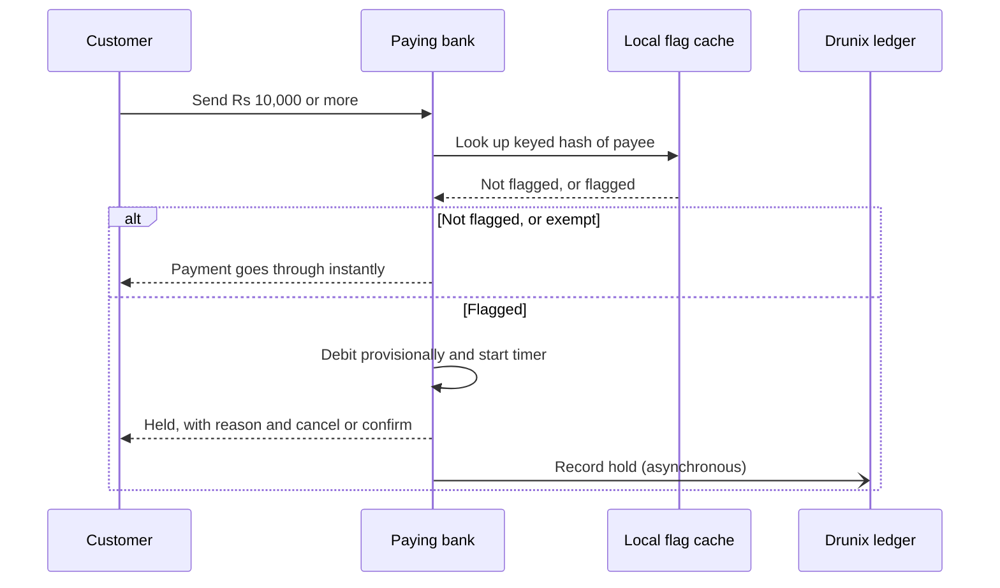
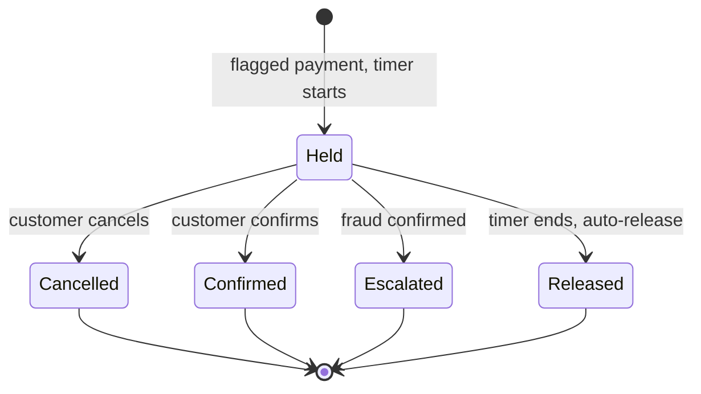

# Prahari

**Targeted, accountable payment holds for UPI, built on Drunix.**
Pause only the risky payment. Let everything else through instantly. Make the bank answer for it when a pause is wrong.

> **Status: design stage (hackathon proposal).**
> The flow, the rules and the simulation method are worked out. There is no running prototype yet, and nothing here has been tested with real banks or real payment data. The Drunix prototype and the simulation are the next steps (see the [roadmap](#13-roadmap)).

Built by Team ERROR:200 for the DRUNIX Hackathon 2026 (Citi x NPCI), track: Real-Time Payments. This is an independent student project. It is not affiliated with, or endorsed by, NPCI, RBI or Citi.

---

## Contents

1. [Why Prahari exists](#1-why-prahari-exists)
2. [What Prahari does in one minute](#2-what-prahari-does-in-one-minute)
3. [What Prahari is not](#3-what-prahari-is-not)
4. [System overview](#4-system-overview)
5. [The full lifecycle](#5-the-full-lifecycle)
6. [Real-time design](#6-real-time-design)
7. [Data model (proposed)](#7-data-model-proposed)
8. [Chaincode design (proposed)](#8-chaincode-design-proposed)
9. [How Drunix is used](#9-how-drunix-is-used)
10. [Privacy, abuse and security](#10-privacy-abuse-and-security)
11. [Simulation plan](#11-simulation-plan)
12. [Repository layout (planned)](#12-repository-layout-planned)
13. [Roadmap](#13-roadmap)
14. [Real versus simulated, and known limits](#14-real-versus-simulated-and-known-limits)
15. [References](#15-references)
16. [Disclaimer and license](#16-disclaimer-and-license)

---

## 1. Why Prahari exists

Reported digital payment fraud in India grew from about 2.6 lakh cases worth Rs 551 crore in 2021 to 28 lakh cases worth Rs 22,931 crore in 2025 (figures cited in RBI's April 2026 discussion paper, as reported by MediaNama). In authorised push payment (APP) fraud, the victim sends the money themselves after being tricked. By the time they realise, the money has usually moved through mule accounts and is hard to recover.

RBI's draft response is to delay APP payments of Rs 10,000 and above by one hour, debiting provisionally so the customer can cancel. The paper allows whitelisting and exempts some payment types (merchant, recurring, cheque). It is a discussion paper, not a rule.

That helps victims, but it also makes honest payers wait, on a network that handled 22.35 billion transactions in April 2026. Three gaps remain:

| Gap | What it means |
|---|---|
| **Banks decide alone** | The receiving side often knows an account looks suspicious. The paying bank, at the moment of payment, often does not. |
| **A blanket delay hits honest payers** | Someone sending money to a relative in an emergency waits too, though nothing about that payment is risky. |
| **Nobody answers for a wrong hold** | When an honest payment is held by mistake, I found no framework for a release deadline or for compensation. |

Prahari is a proposal for closing those three gaps without changing UPI itself.

## 2. What Prahari does in one minute

1. A bank, or a risk tool such as MuleHunter.ai, **flags a suspicious account**. The flag is signed, carries a risk level, a reason code and an expiry, and is published to a shared Drunix channel.
2. Every participating bank keeps a **local copy** of the flag list, updated within seconds.
3. When a payment of Rs 10,000 or more is sent, the paying bank **checks its own local list**. This takes milliseconds and never calls the ledger.
4. If the payee is **not flagged**, or the payment is exempt, it goes through instantly.
5. If the payee is **flagged**, the bank debits provisionally and **holds the payment for a short window** (one hour, matching RBI's proposal). The customer sees why and can cancel or confirm.
6. The bank writes the hold to the ledger: payment reference, reason code, timer, and who decided. The hold **ends** by cancellation, confirmation, escalation or timeout.
7. Simple **accountability rules** decide who compensates the customer if the hold was wrong or ran late.

## 3. What Prahari is not

- Not a new payment rail. UPI is unchanged and the payment never waits for the ledger.
- Not a fraud detector. Risk signals come from banks and tools such as MuleHunter.ai. In this project they are simulated.
- Not a replacement for MuleHunter.ai or any national tool. It consumes their signals and adds sharing, timing and accountability.
- Not legal or regulatory advice. The accountability rules are proposals that a regulator could change.

## 4. System overview

### Participants

| Participant | Role |
|---|---|
| **Paying bank** | Checks payments against its local flag list, places and ends holds, writes outcomes to the ledger. |
| **Receiving bank / risk source** | Publishes signed flags about accounts it sees as suspicious. |
| **Regulator (read-only)** | Sees aggregate statistics by default and case details on request, with each access logged. |
| **Customer** | Sees why a payment was held and can cancel, confirm, or dispute a flag. |

### Architecture



The payment check happens **inside the paying bank**, against its local cache. The ledger is used to share flags beforehand and to record outcomes afterwards.

## 5. The full lifecycle

### 5.1 Flag lifecycle



| State | Meaning |
|---|---|
| Published / Active | Flag is on the channel and every bank's cache applies it. |
| Expired | Flags lapse on their own (default 24 hours) so nobody stays flagged indefinitely. |
| Revoked | The raising bank withdrew it, or a dispute was upheld. |
| Disputed | The account holder has challenged the flag. Holds on this account use the dispute-path rules below. |

### 5.2 Payment check (real-time path)



The lookup never calls the ledger. The ledger write happens **after** the decision.

### 5.3 Hold lifecycle



| Outcome | What happens | Counts toward the raising bank's accuracy? |
|---|---|---|
| **Cancelled** | Money returns to the customer. | No (ambiguous: fraud may or may not have been avoided). |
| **Confirmed** | Customer insists, payment goes through. | No (ambiguous). |
| **Escalated** | Fraud is confirmed and the case is handed on. | Yes, positive. |
| **Released** | Timer ran out, payment goes through on its own. | Only if a dispute is upheld (see 5.5). |

Neutral outcomes deliberately do not change anyone's score, so no bank is rewarded for flagging at random.

### 5.4 Accountability rules (proposed)

These are proposals, not RBI or NPCI rules. A regulator could change any of them, and the compensation amount is a parameter for regulators to set.

| Situation | Proposed outcome |
|---|---|
| The flag was valid (in date, with evidence) | Nobody owes anything. |
| The flag had expired, or had no evidence behind it | The bank that raised the flag compensates the customer for the delay. |
| The hold ran past its timer | The holding bank compensates the customer, and the payment is released automatically. |
| A bank's flags are wrong too often | Its accuracy score drops, and its flags need stronger evidence before they can trigger a hold. |

### 5.5 Accuracy score and evidence levels (proposed)

- **Score:** a rolling measure per bank, for example `escalated / (escalated + disputes_upheld)` over a fixed window. The exact formula is an open design question.
- **Evidence levels:** L0 reason code only; L1 reference to a case or complaint; L2 corroborated by a second bank or a national signal.
- **Effect:** banks below a score threshold need a higher evidence level before their flags can trigger a hold. The score never blocks a bank from publishing, it only raises the bar.

### 5.6 Dispute and release path

1. The account holder raises a dispute with their own bank.
2. The bank records a dispute against the flag. While open, holds on this account use a shorter window and a higher evidence requirement (configurable).
3. If upheld, the flag is revoked and counts against the raising bank's score. If rejected, it stays active.

### 5.7 End-to-end summary

```
flag raised -> signed -> published -> cached by every bank
   -> payment checked locally -> pass instantly  OR  hold with timer
   -> hold recorded on ledger -> cancel / confirm / escalate / auto-release
   -> accountability evaluated -> compensation (if any) -> score updated
   -> regulator sees statistics
```

## 6. Real-time design

The hold decision runs inside each bank. The ledger is never on the payment path.

| When | What happens | Where | Speed (design target, **not yet measured**) |
|---|---|---|---|
| Before the payment | Flags published and copied to each bank's local cache | Ledger events to bank cache | Seconds |
| At the payment | Bank checks its cache and holds or passes | Inside the paying bank | Milliseconds |
| After the payment | Hold, release and reason code written to the ledger | Ledger, asynchronous | Seconds, off the payment path |
| Later | Compensation and accuracy scores updated | Ledger and reports | Not time-critical |

**How "timers" work on a ledger.** Chaincode only changes state when a transaction arrives, so it cannot run a clock on its own. A timer is therefore a **deadline recorded on the ledger**. A small watcher service in each bank submits a `ReleaseHold` transaction when the deadline passes, and any participant can submit it. Overrun is measured as the release transaction's timestamp minus the deadline. *Open question:* which time source to trust (transaction timestamp, block time) and what tolerance to allow.

**Cache freshness.** Banks subscribe to chaincode events to update their caches. A very fresh flag may not have reached every bank yet, which is why Prahari reduces risk but cannot remove it.

## 7. Data model (proposed)

These schemas are design proposals, not implemented code.

**Flag**
```json
{
  "flagId": "f-000123",
  "accountHash": "hmac-sha256 of account identifier (keyed)",
  "riskLevel": "HIGH",
  "reasonCode": "R07",
  "evidenceLevel": "L1",
  "raisedBy": "BankA",
  "issuedAt": "2026-10-25T10:00:00Z",
  "expiresAt": "2026-10-26T10:00:00Z",
  "status": "ACTIVE",
  "signature": "..."
}
```

**Hold record**
```json
{
  "holdId": "h-000987",
  "paymentRef": "bank-internal reference",
  "flagId": "f-000123",
  "decidedBy": "BankB",
  "startedAt": "2026-10-25T10:05:00Z",
  "deadline": "2026-10-25T11:05:00Z",
  "state": "HELD",
  "outcome": null,
  "compensation": null
}
```

**Policy (regulator-tunable)**

| Parameter | Prototype value | Note |
|---|---|---|
| `thresholdAmount` | Rs 10,000 | From RBI's discussion paper |
| `holdWindowMinutes` | 60 | From RBI's discussion paper |
| `flagTtlHours` | 24 | Prahari's proposal |
| `compensation` | set by regulator | Placeholder in the prototype |
| `minEvidenceLevel` | L0, rising for low-score banks | Prahari's proposal |

## 8. Chaincode design (proposed)

Language: Go (planned). Three contracts:

| Contract | Responsibility | Key functions |
|---|---|---|
| **FlagRegistry** | Stores signed, expiring flags and their disputes | `PublishFlag`, `RevokeFlag`, `DisputeFlag`, `ResolveDispute`, `GetFlag` |
| **HoldManager** | Records holds, enforces deadlines, records outcomes | `RecordHold`, `CancelHold`, `ConfirmHold`, `EscalateHold`, `ReleaseHold`, `GetHold` |
| **AccountabilityRules** | Applies the rules in 5.4, updates scores | `EvaluateHold`, `ApplyCompensation`, `UpdateAccuracy`, `GetPolicy`, `SetPolicy` |

Endorsement policy (proposed): a flag needs the raising bank's signature; a hold record needs the deciding bank's signature; `SetPolicy` needs the regulator organisation plus a majority of banks.

## 9. How Drunix is used

Drunix is NPCI's open-source (Apache-2.0) enhanced fork of Hyperledger Fabric.

| Drunix capability | Use in Prahari |
|---|---|
| Multi-organisation network | Paying bank, receiving bank or risk source, and regulator are separate organisations that must rely on one record. |
| Chaincode | The three contracts above. |
| KeyDB transient store / private data | Evidence behind a flag stays between the banks involved. Only hashes and outcomes go on the shared ledger. |
| SQL state storage (YugabyteDB) | The regulator can query hold and release statistics without custom indexing. |
| Lite Peer / Committing Peer separation | Endorsing and committing can scale separately as flags and holds grow. |

Not planned for use: the stateless validation service, Falcon, other tooling.

Exact feature names should be checked against the official Drunix documentation before any claim is made in a presentation.

## 10. Privacy, abuse and security

### Privacy by design

- Only keyed hashes, risk levels, reason codes and expiry times go on the shared ledger. No names, account numbers or phone numbers.
- Flags expire on their own.
- Regulator access is aggregate by default, with case-level access on request and each access logged.
- A plain hash of an account number can be guessed, so hashes are **keyed** (HMAC) with a key shared only among participating banks.

### Threats and mitigations (proposed)

| Threat | Mitigation |
|---|---|
| **Malicious or careless flagging**: a bank flags a rival's customers or flags at random | Evidence levels, per-bank flag rate limits, accuracy score, compensation when a flag lacks grounds |
| **Collusion or a flood of bad flags** | Score-weighted trust, caps on flags per period, regulator visibility of flag rates |
| **Stale flags holding honest people** | Short default expiry, dispute path, auto-release at the deadline |
| **Replay of old flags or holds** | Unique IDs, issuance times, signature checks in chaincode |
| **Insider guessing of hashed accounts** | Keyed hashing, key rotation, minimal data shared |
| **Fresh mule accounts that were never flagged** | Not solved by Prahari. It reduces risk and relies on upstream detectors. |

### Open questions (honest list)

- Key distribution and rotation for the keyed hash across banks.
- Which time source to trust for deadlines.
- The exact accuracy-score formula and thresholds.
- Legal basis for holding funds and for the compensation rules. This needs regulators and lawyers.
- Whether deleting data under data protection law is compatible with ledger records (the design keeps personal data off the ledger for this reason, and this still needs legal review).

## 11. Simulation plan

The simulation is what turns "targeted holds are better" from a claim into a measured result, or shows that they are not.

**Compare two rules on the same synthetic payments**

- **Rule A (blanket):** hold every non-exempt payment of Rs 10,000 or more for one hour.
- **Rule B (Prahari):** hold only payments to flagged accounts.

**Inputs (all adjustable)**

| Input | Notes |
|---|---|
| Number of payments, share in scope, fraud rate | Assumptions, clearly marked |
| Average fraud payment value | Default derived from public data: Rs 22,931 crore / 28 lakh cases is about Rs 81,900 |
| Flag recall | Share of fraud payments that go to flagged accounts. Sweep 30% to 90%. |
| False-flag rate | Share of honest in-scope payments that go to flagged accounts. Sweep 0.25% to 2%. |
| Share of held fraud that is stopped | Same under both rules |

**Outputs**

1. Honest payments delayed under A and B.
2. Fraud value stopped under A and B.
3. Fraud value stopped per honest payment delayed.
4. A sensitivity grid across recall and false-flag rate.
5. Abuse scenarios: a flood of bad flags, a wrongly flagged merchant, late releases.

**Reading the results honestly.** If the targeted rule does not beat the blanket delay across a sensible range, that is a finding too, and it will be reported. Results depend entirely on assumed flag accuracy, which can only be measured in a pilot with real banks.

**Illustration (arithmetic, not a forecast):** preventing 1% of Rs 22,931 crore is about Rs 229 crore a year, and 5% is about Rs 1,147 crore.

## 12. Repository layout (planned)

These folders do not all exist yet. This is the intended structure.

```
prahari/
  README.md
  docs/            design notes, diagrams, pitch deck
  simulation/      Python simulation, seeded and reproducible
  chaincode/       Go chaincode: flags, holds, accountability
  network/         Drunix test network configuration (3 organisations)
  services/        bank-side cache and watcher services
  dashboard/       simple regulator statistics view
  scripts/         demo and failure-injection scripts
```

## 13. Roadmap

- [x] Problem framing and design
- [x] Lifecycle, accountability rules and proposed data model
- [ ] Python simulation with a sensitivity grid
- [ ] Drunix test network with three organisations
- [ ] Chaincode: FlagRegistry, HoldManager, AccountabilityRules
- [ ] Bank-side cache and watcher services (simulated banks)
- [ ] Regulator statistics view
- [ ] Failure-injection demo: a wrong flag, a late release, a flood of bad flags
- [ ] Measured throughput on a real Drunix network
- [ ] Legal and policy review of the accountability rules

## 14. Real versus simulated, and known limits

| Real in the planned prototype | Simulated |
|---|---|
| A running Drunix test network with three organisations | The banks themselves and UPI |
| Chaincode, signatures and an audit trail | The risk model that produces flags |
| A Python simulation comparing the two rules | Fraud cases and honest payments |

**Known limits**

- A brand-new mule account can pass before anyone has flagged it.
- Flags take a few seconds to spread.
- Impact figures come from simulation, not live data.
- The accountability rules are proposals and need regulator and legal review.
- Speed and scale figures in this document are design targets, not measurements.

## 15. References

- RBI discussion paper on digital payment safeguards, April 2026, as reported by MediaNama: https://www.medianama.com/2026/04/223-rbi-1-hour-delay-digital-payment-fraud-safeguards/
- MuleHunter.ai, the I4C and RBI Innovation Hub MoU, and UPI volume, as reported by ClearingPost: https://clearingpost.com/insights/i4c-rbih-mulehunter-ai-banking-fraud-detection-may-2026/
- UK rules allowing delay of suspicious payments, as summarised by Hogan Lovells: https://www.hlc.com/en/publications/app-fraud-uk-government-publishes-draft-legislation-allowing-psps-to-delay-payments-for-fraud-concerns
- Drunix (NPCI): https://github.com/npci/drunix
- Drunix architecture notes: https://github.com/npci/drunix/blob/main/docs/drunix-arch.md

## 16. Disclaimer and license

This is a hackathon proposal and a design exercise, not a production system and not financial, legal or regulatory advice. Figures are taken from the sources above and should be re-checked before being reused. Nothing here is an RBI, NPCI or Citi rule or position.

License: Apache License 2.0 (add a `LICENSE` file to the repository).
